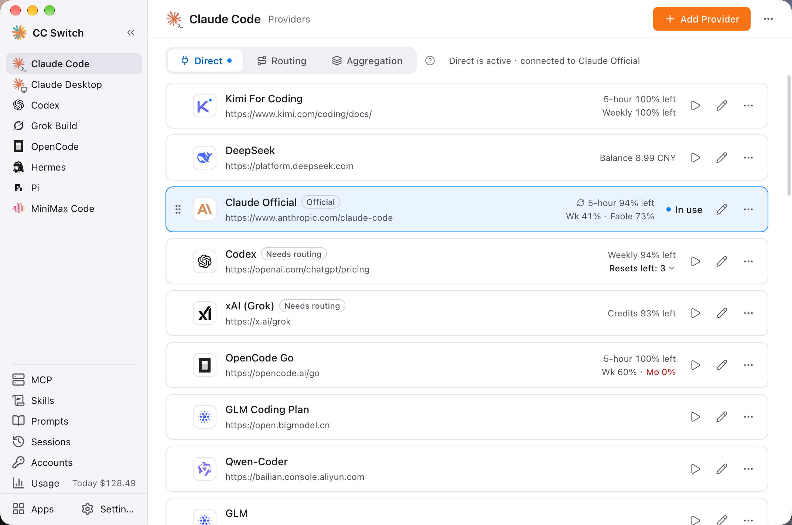
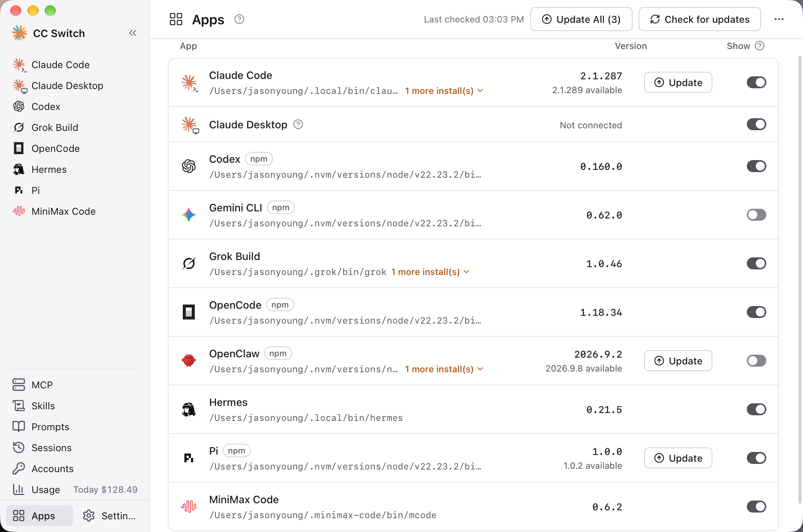
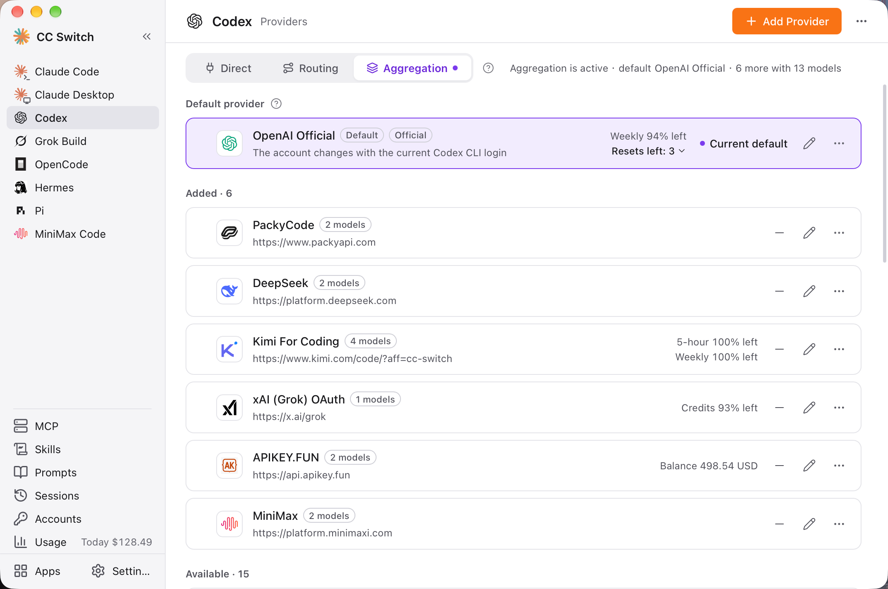
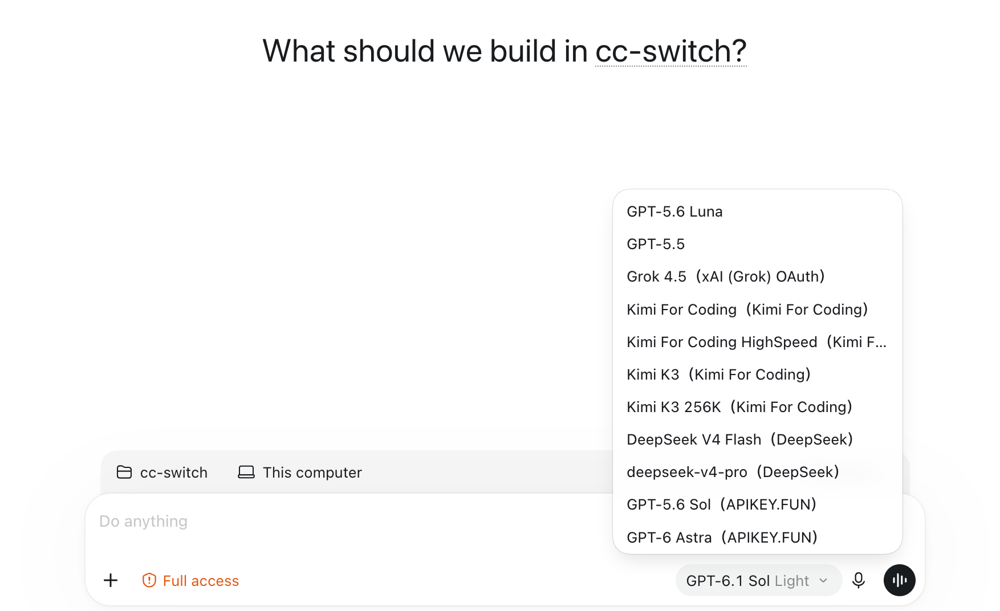
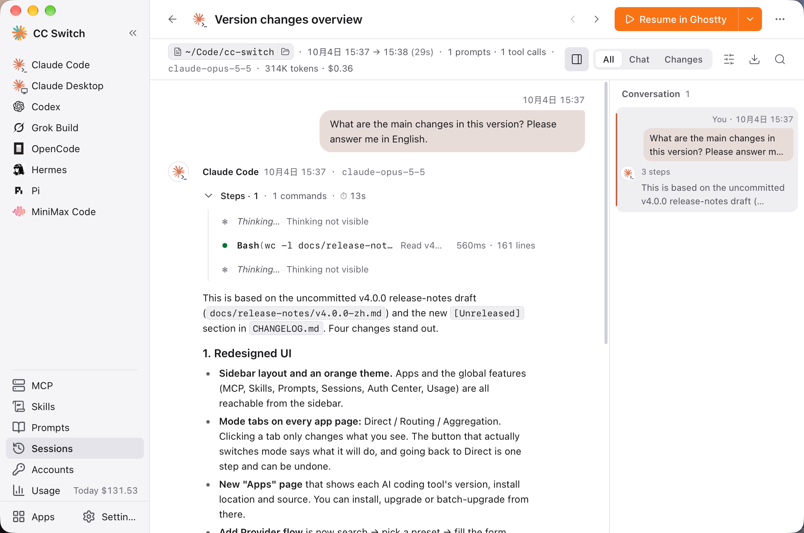
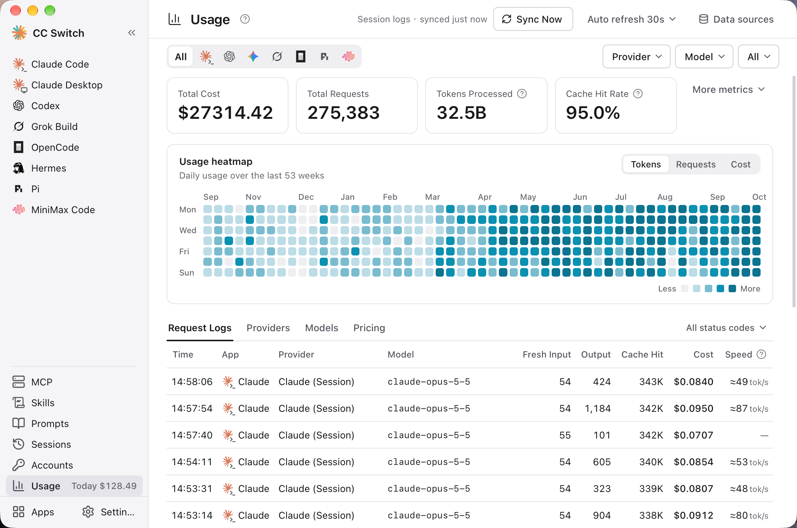

<div align="center">

# VV Code

### Der All-in-One-Manager für Claude Code, Claude Desktop, Codex, Gemini CLI, Grok Build, OpenCode, OpenClaw, Hermes Agent, Pi, MiniMax Code, Kimi Code & Oh My Pi

**API-Anbieter mit einem Klick wechseln und MCP, Skills und Prompts zentral verwalten — ohne JSON-, TOML- oder YAML-Konfigurationsdateien von Hand zu bearbeiten.**

[](https://github.com/PiuQiuPiaQia/api-switch/releases)
[](https://github.com/PiuQiuPiaQia/api-switch/releases)
[](https://tauri.app/)
[](https://github.com/PiuQiuPiaQia/api-switch/releases/latest)

<a href="https://www.star-history.com/#PiuQiuPiaQia/api-switch&Date"><picture><source media="(prefers-color-scheme: dark)" srcset="https://api.star-history.com/badge?repo=PiuQiuPiaQia/api-switch&theme=dark" /></picture></a>

### 🌐 Die einzige offizielle Website: **[vvcode.top](https://vvcode.top)**

[English](README.md) | [中文](README_ZH.md) | [日本語](README_JA.md) | Deutsch | [Changelog](CHANGELOG.md)

**[Download](#download--installation) · [Schnellstart](#schnellstart) · [Funktionen](#funktionen) · [FAQ](#faq) · [Benutzerhandbuch (Englisch)](docs/user-manual/en/README.md)**

</div>

## Warum VV Code?

Claude Code, Codex, Gemini CLI und andere KI-Programmierwerkzeuge haben jeweils ihr eigenes Konfigurationsformat. Wer den API-Anbieter wechselt, muss JSON-, TOML-, YAML- oder `.env`-Dateien von Hand bearbeiten; auch MCP, Skills und Prompts müssen in jedem Werkzeug einzeln gepflegt werden.

**VV Code** bündelt all das in einer einzigen Desktop-App: Preset auswählen, Schlüssel eintragen und mit einem Klick wechseln. Beim Wechsel werden nur die Verbindungsdaten — Endpunkt, Schlüssel und Modell — ersetzt; selbst hinzugefügte Plugins, Hooks, MCP und Kommentare bleiben unverändert.

- **Eine App, zwölf Werkzeuge** — Claude Code, Claude Desktop, Codex, Gemini CLI, Grok Build, OpenCode, OpenClaw, Hermes, Pi, MiniMax Code, Kimi Code, Oh My Pi
- **Kein manuelles Bearbeiten mehr** — 90+ Anbieter-Presets einschließlich AWS Bedrock, NVIDIA NIM und Community-Relays
- **Direct, Routing oder Aggregation — ganz nach Bedarf** — Bei Direct verbindet sich das Werkzeug direkt mit dem Anbieter; Routing leitet die Anfragen über Ihren Rechner, konvertiert dabei Schnittstellenformate und bietet automatisches Failover, sodass Claude Code GPT und Codex Claude nutzen kann; Aggregation bringt die Modelle mehrerer Anbieter in eine gemeinsame Modellliste von Claude Code oder Codex — welches Modell Sie wählen, entscheidet, an welchen Anbieter die Anfrage geht
- **MCP, Skills & Prompts zentral verwalten** — MCP und Skills einmal hinzufügen und pro Werkzeug per Häkchen synchronisieren; Prompts werden je Werkzeug separat gepflegt
- **Sessions, die man lesen kann** — Die Sitzungsprotokolle der Werkzeuge werden zu einer Leseansicht aufbereitet: Was in jeder Runde passiert ist, welche Dateien geändert wurden und welcher Schritt fehlgeschlagen ist, sehen Sie auf einen Blick
- **Nutzung und Kontingente auf einen Blick** — Token-Verbrauch und Kosten werden auch ohne lokales Routing erfasst; das verbleibende Abo-Kontingent und das Kontoguthaben erscheinen direkt auf den Anbieterkarten und im System-Tray
- **Plattformübergreifend** — Native Desktop-App für Windows, macOS und Linux, gebaut mit Tauri 2

## Screenshots

<table>
<tr>
<td align="center" width="50%"><br>Hauptoberfläche</td>
<td align="center" width="50%"><br>Apps-Seite</td>
</tr>
<tr>
<td align="center"><br>Aggregationsmodus</td>
<td align="center"><br>Aggregierte Modellliste in Codex</td>
</tr>
<tr>
<td align="center"><br>Session-Leseansicht</td>
<td align="center"><br>Nutzungsstatistik</td>
</tr>
</table>

## Download & Installation

### Systemanforderungen

- **Windows**: Windows 10 und höher
- **macOS**: macOS 12 (Monterey) und höher
- **Linux**: x86_64 oder ARM64 mit glibc 2.35+ und WebKitGTK 4.1 — z. B. Ubuntu 22.04+, Debian 12+ und aktuelle Fedora-Versionen; RHEL / Rocky / Alma 8–9 werden derzeit nicht unterstützt

### Windows-Nutzer

Laden Sie das neueste Installationsprogramm `VV-Code-v{version}-Windows.msi` oder die portable Version `VV-Code-v{version}-Windows-Portable.zip` von der Seite [Releases](../../releases) herunter. Unter Windows on ARM laden Sie `VV-Code-v{version}-Windows-arm64.msi` oder `VV-Code-v{version}-Windows-arm64-Portable.zip` herunter.

### macOS-Nutzer

**Manueller Download**

Laden Sie `VV-Code-v{version}-macOS.dmg` (empfohlen) oder `.zip` von der Seite [Releases](../../releases) herunter. Es handelt sich um einen Universal-Build, der nativ auf Apple-Silicon- und Intel-Macs läuft.

> **Hinweis**: VV Code für macOS ist von Apple code-signiert und notarisiert. Sie können es direkt installieren und öffnen.

### Linux-Nutzer

Laden Sie den neuesten Linux-Build von der Seite [Releases](../../releases) herunter:

- `VV-Code-v{version}-Linux-x86_64.deb` / `-Linux-arm64.deb` (Debian/Ubuntu)
- `VV-Code-v{version}-Linux-x86_64.rpm` / `-Linux-arm64.rpm` (Fedora und andere RPM-Distributionen mit WebKitGTK 4.1)
- `VV-Code-v{version}-Linux-x86_64.AppImage` / `-Linux-arm64.AppImage` (jede Distribution, die die obigen Systemanforderungen erfüllt)

> **Flatpak**: Nicht in den offiziellen Releases enthalten. Sie können es selbst aus dem `.deb` bauen — eine Anleitung finden Sie unter [`flatpak/README.md`](flatpak/README.md).

## Schnellstart

### Grundlegende Verwendung

1. **Anbieter hinzufügen**: Wählen Sie in der Seitenleiste das Werkzeug aus, das Sie verwalten möchten, und klicken Sie oben rechts auf der Seite auf „+“ („Add Provider“) → Wählen Sie ein Preset oder erstellen Sie eine eigene Konfiguration
2. **Anbieter wechseln**:
   - Hauptoberfläche: Anbieter auswählen → auf „Enable“ klicken (bei OpenCode, OpenClaw, Hermes, MiniMax Code und Kimi Code heißt die Schaltfläche „Add“, bei Pi und Oh My Pi „Enable“ / „Remove“; diese sieben Werkzeuge arbeiten im Parallelmodus, sodass Sie mehrere Anbieter gleichzeitig hinzufügen können)
   - System-Tray: Jedes Werkzeug hat eine eigene Zeile mit Name, Modus, Anbieter und Kontingent; klicken Sie im Untermenü direkt auf den Anbieternamen (Claude Code, Claude Desktop, Codex, Gemini CLI, Grok Build)
3. **Wirksam werden**: Claude Code erfordert keinen Neustart; bei Codex, Gemini CLI und Grok Build starten Sie das Terminal oder das CLI-Werkzeug neu, bei Claude Desktop die App selbst (siehe FAQ)
4. **Zurück zum offiziellen Login**: Wechseln Sie zum mitgelieferten offiziellen Anbieter in der Liste (z. B. „Claude Official“), starten Sie das Werkzeug neu und folgen Sie dann seinem Login-/OAuth-Vorgang
5. **Routing und Aggregation (optional)**: Die Seiten von Claude Code, Codex, Gemini CLI und Grok Build haben oben die Tabs „Direct“ / „Routing“, Claude Code und Codex zusätzlich „Aggregation“. Ein Klick auf einen Tab wechselt nur die Ansicht und ändert keine Konfiguration; um tatsächlich umzuschalten, klicken Sie auf der Seite auf „Start routing“ oder „Switch to Aggregation“, zurück geht es mit „Back to direct“. Wenn Sie in Claude Code Anbieter im OpenAI- oder Gemini-Format nutzen oder Claude in Codex verwenden möchten, nehmen Sie Routing; wenn Sie Modelle mehrerer Anbieter in derselben Modellliste mischen möchten, nehmen Sie Aggregation
6. **Werkzeuge verwalten**: Die Seite „Apps“ in der Seitenleiste zeigt für jedes KI-Programmierwerkzeug Version, Installationsort und Quelle; dort können Sie installieren, aktualisieren oder alle auf einmal aktualisieren und auswählen, welche Werkzeuge in der Seitenleiste erscheinen

### MCP, Prompts, Skills, Projekte & Sessions

- **MCP**: Klicken Sie in der Seitenleiste auf „MCP“ → Server über Vorlagen oder eigene Konfiguration hinzufügen (oder „Import Existing“) → Synchronisierung pro Werkzeug umschalten
- **Prompts**: Klicken Sie in der Seitenleiste auf „Prompts“ → Prompts mit dem Markdown-Editor erstellen → nach dem Aktivieren wird der Prompt in die Prompt-Datei des Werkzeugs geschrieben
- **Skills**: Klicken Sie in der Seitenleiste auf „Skills“ → „Discover Skills“ → skills.sh durchsuchen oder GitHub-Repositorys durchstöbern → mit einem Klick in unterstützte Werkzeuge installieren
- **Projekte**: Aktivieren Sie zuerst unter „Settings → General“ die Option „Show project switcher“; öffnen Sie dann auf der Seite von Claude Code, Claude Desktop oder Codex den Projektumschalter oben → „New project“, um die aktuelle Konfiguration zu speichern; später wählen Sie das Projekt einfach im Umschalter aus, um die gesamte Konfiguration auf einmal zu wechseln
- **Sessions**: Klicken Sie in der Seitenleiste auf „Sessions“ → Sitzungsverlauf durchsehen und durchsuchen, die Leseansicht öffnen oder Sessions der einzelnen Werkzeuge fortsetzen
- **Accounts**: Klicken Sie in der Seitenleiste auf „Accounts“ und melden Sie sich bei GitHub-Copilot-, ChatGPT-, xAI-(Grok-) und Kimi-Code-Konten an, um die Abonnements als Anbieter zu nutzen. Kimi Code unterstützt mehrere offizielle Konten mit jeweils eigenen Zugangsdaten und einem eigenen nativen Anbieter. Die erste Anmeldung verwendet den nativen Standard-Speicherplatz für Zugangsdaten. Hinzufügen, erneute Anmeldung und Abmeldung erfolgen hier. Offizielle Kimi-OAuth-Knoten in der nativen Konfiguration sind auf der Anbieterseite geschützt; nach dem Entfernen eines nativen Knotens kann sein gespeichertes Profil gelöscht werden.

> **Hinweis**: Beim Erststart importiert VV Code Ihre bestehende Konfiguration von Claude Code, Codex, Gemini CLI und Grok Build automatisch als Anbieter namens `default` und fügt für diese Werkzeuge sowie für Claude Desktop jeweils den offiziellen Anbieter hinzu, sodass nichts von Ihrer bisherigen Konfiguration verloren geht.

Ausführliche Anleitungen zu allen Funktionen finden Sie im **[Benutzerhandbuch](docs/user-manual/en/README.md)** (auf Englisch) — es deckt sämtliche Funktionen ab, darunter Anbieterverwaltung, MCP/Prompts/Skills sowie lokales Routing & Failover.

## Funktionen

[Vollständiges Changelog](CHANGELOG.md) | [Release Notes zu v4.0](docs/release-notes/v4.0.4-en.md)

### Funktionen je Werkzeug

| Werkzeug | Anbieter | Lokales Routing | Aggregation | Tray-Umschaltung | MCP | Skills | Prompts | Sessions | Nutzungsstatistik |
| --- | --- | :---: | :---: | :---: | :---: | :---: | --- | :---: | :---: |
| Claude Code | Wechsel | ✓ | ✓ | ✓ | ✓ | ✓ | CLAUDE.md | ✓ | ✓ |
| Claude Desktop | Wechsel | nur Model Mapping | – | ✓ | – | – | – | – | nur Model Mapping |
| Codex | Wechsel | ✓ | ✓ | ✓ | ✓ | ✓ | AGENTS.md | ✓ | ✓ |
| Gemini CLI | Wechsel | ✓ | – | ✓ | ✓ | ✓ | GEMINI.md | ✓ | ✓ |
| Grok Build | Wechsel | ✓ | – | ✓ | ✓ | ✓ | AGENTS.md | ✓ | ✓ |
| OpenCode | Parallel | – | – | – | ✓ | ✓ | AGENTS.md | ✓ | ✓ |
| OpenClaw | Parallel | – | – | – | – | – | Workspace-Editor | ✓ | – |
| Hermes | Parallel | – | – | – | ✓ | ✓ | Memory-Verwaltung | ✓ | – |
| Pi | Parallel | – | – | – | ✓ | ✓ | AGENTS.md, SYSTEM.md, Prompt-Vorlagen | ✓ | ✓ |
| MiniMax Code | Parallel | – | – | – | ✓ | ✓ | AGENTS.md | ✓ | ✓ |
| Kimi Code | Parallel | – | – | – | ✓ | ✓ | AGENTS.md | ✓ | ✓ |
| Oh My Pi | Parallel | – | – | – | ✓ | ✓ | AGENTS.md | ✓ | – |

- **Wechsel**: Es ist jeweils nur ein Anbieter aktiv; **Parallel**: Mehrere Anbieter werden gleichzeitig in die eigene Konfiguration des Werkzeugs geschrieben; welcher verwendet wird, wählen Sie im Werkzeug aus.
- **Lokales Routing**: VV Code leitet Anfragen auf Ihrem Rechner weiter und konvertiert dabei die Schnittstellenformate, siehe [Lokales Routing & Failover](#lokales-routing--failover) weiter unten. Für Anbieter von Claude Desktop können Sie „Direct“ oder „Model Mapping“ wählen; bei „Model Mapping“ laufen die Anfragen über das lokale Routing.
- **Aggregation**: Bringt die Modelle mehrerer Anbieter in eine gemeinsame Modellliste und verteilt die Anfragen je nach gewähltem Modell, siehe [Aggregationsmodus](#aggregationsmodus) weiter unten.
- **Sessions**: Sitzungsverlauf durchsehen und durchsuchen, die Leseansicht öffnen, Befehl zum Fortsetzen kopieren und das Gespräch weiterführen (Sessions von OpenClaw und Hermes lassen sich derzeit nicht fortsetzen). Bei Hermes werden nur die neuesten 500 Sessions angezeigt.
- **Nutzungsstatistik**: Ohne lokales Routing wird sie aus den lokalen Sitzungsprotokollen der einzelnen Werkzeuge erstellt; Anfragen über das lokale Routing werden ebenfalls erfasst.
- Die auf der Claude-Desktop-Seite geöffneten Panels für MCP, Skills, Prompts und Sessions wirken auf Claude Code.

### Anbieterverwaltung

- **90+ Anbieter-Presets** — Preset auswählen und Schlüssel eintragen, um einen Anbieter hinzuzufügen; alternativ können Sie eine eigene Konfiguration erstellen. Im Hinzufügen-Panel lässt sich nach chinesischen Namen und Domains suchen; verschiedene Tarife und Regionen desselben Anbieters sind in einer Zeile zusammengefasst
- **Nur Kernfelder** — Beim Wechsel werden nur die Verbindungsdaten wie Endpunkt, Schlüssel und Modell ersetzt; Plugins, Hooks, MCP, selbst hinzugefügte Einstellungen und Kommentare bleiben unverändert. Unten im Editor sehen Sie, wie die Konfigurationsdatei nach dem Wechsel aussieht, und bevor VV Code eine Konfigurationsdatei zum ersten Mal umschreibt, sichert es automatisch das Original
- **Projekte** — Speichern Sie den aktuellen Anbieter sowie MCP, Skills und Prompt-Dateien von Claude Code oder Codex als Projekt (bei Claude Desktop nur den Anbieter) und wechseln Sie später über den Projektumschalter oben auf der Seite oder über das System-Tray mit einem Klick die gesamte Konfiguration; beim Wechsel zu einem anderen Projekt wird der aktuelle Zustand automatisch im bisherigen Projekt gespeichert. Der Projektumschalter ist standardmäßig ausgeblendet; aktivieren Sie ihn unter „Settings → General“ mit „Show project switcher“
- **Accounts (Beta)** — Melden Sie sich auf der Seite „Accounts“ in der Seitenleiste bei mehreren GitHub-Copilot-, ChatGPT- und xAI-(Grok-)Konten an und nutzen Sie die Abonnements als Anbieter in Claude Code, Claude Desktop und Codex (außer bei OpenAI Official in Codex jeweils im Routing-Modus). Die Nutzung von Abonnements außerhalb der offiziellen Clients kann gegen die Nutzungsbedingungen des Herstellers verstoßen — bitte schätzen Sie das Risiko selbst ein
- **Claude Desktop mit Drittanbietern** — Direkte Verbindung zu Anthropic-kompatiblen Endpunkten möglich; für Nicht-Claude-Modelle wählen Sie „Model Mapping“, dann bildet das lokale Routing Stufen wie Sonnet, Opus und Haiku auf die tatsächlichen Modelle des Anbieters ab
- **Universelle Anbieter** — Eine Konfiguration synchronisiert sich mit Claude Code, Codex und Gemini CLI
- Umschaltung mit einem Klick, Schnellumschaltung über System-Tray (Claude Code, Claude Desktop, Codex, Gemini CLI, Grok Build), Sortierung per Drag-and-drop, Import/Export

### Lokales Routing & Failover

- **Formatkonvertierung** — Das lokale Routing konvertiert Anfragen zwischen Anthropic Messages, OpenAI Chat Completions, OpenAI Responses und Gemini Native: Claude Code und Claude Desktop können Anbieter im OpenAI- oder Gemini-Format nutzen, Codex und Grok Build Anbieter im Chat-Completions- oder Anthropic-Messages-Format
- **Pro Werkzeug aktivierbar** — Claude Code, Codex, Gemini CLI und Grok Build lassen sich jeweils einzeln in den Routing-Modus schalten: Klicken Sie oben auf der Seite im Tab „Routing“ auf „Start routing“. Im Routing-Modus wirkt ein Anbieterwechsel sofort auf die folgenden Anfragen (ändert der Wechsel das Modell, kann bei Codex, Gemini CLI und Grok Build trotzdem ein Neustart nötig sein). Beim Beenden von VV Code wird zuerst die Direct-Konfiguration zurückgeschrieben; beim nächsten Start verbindet sich das Routing wieder
- **Automatisches Failover** — Konfigurieren Sie für jedes Werkzeug eine Failover-Warteschlange; schlägt eine Anfrage fehl, wird automatisch der nächste Anbieter in der Warteschlange verwendet — ergänzt durch Circuit Breaker und Anbieter-Health-Monitoring
- **Request-Rectifier** — Korrigiert automatisch bestimmte Anfragen, die mit dem Upstream nicht kompatibel sind (z. B. Thinking-Signaturen, Herabstufung, wenn keine Bilder unterstützt werden)
- Offizielle Anbieter (z. B. Claude Official) können nicht über das lokale Routing laufen (ausgenommen OpenAI Official von Codex)
- Status, Listen-Adresse und Failover-Parameter des Routing-Dienstes finden Sie gesammelt unter „Settings → Local routing“
- Anleitungen (auf Englisch): [GPT in Claude Code nutzen](docs/guides/claude-codex-routing-guide-en.md) · [Claude in Codex nutzen](docs/guides/codex-claude-routing-guide-en.md)

### Aggregationsmodus

- **Eine Modellliste, mehrere Anbieter** — Wechseln Sie auf der Seite von Claude Code oder Codex zu „Aggregation“ und fügen Sie einige Anbieter hinzu; ihre Modelle erscheinen dann gemeinsam in der Modellauswahl des Clients. Welches Modell Sie wählen, entscheidet, an welchen Anbieter die Anfrage geht — ohne Umweg über VV Code
- **Jederzeit hinzufügen und entfernen** — Klicken Sie auf der Anbieterkarte auf „Add“ oder „Remove“ und bestimmen Sie einen Anbieter als Standard; er übernimmt alle Anfragen, die kein aggregiertes Modell angeben. OpenAI Official in Codex kann nur Standardanbieter sein; offizielle Claude-Abonnements werden im Aggregationsmodus derzeit nicht unterstützt
- **Hinweise** — Aggregation bietet kein Failover; Claude Code wird ab Version 2.1.243 benötigt; Codex muss nach Änderungen an der aggregierten Liste neu gestartet werden, Claude Code nicht. Wechseln Sie innerhalb einer Session das Modell, muss das neue Modell den Prompt-Cache neu aufbauen, sodass die erste Runde etwas mehr kostet
- Viele Designideen des Aggregationsmodus stammen von [opencodex](https://github.com/lidge-jun/opencodex) — danke an den Autor und alle Mitwirkenden
- Dokumentation: [Handbuch zum Aggregationsmodus (Englisch)](docs/user-manual/en/4-proxy/4.6-aggregation.md) · [Illustrierte Anleitung (Chinesisch)](docs/guides/aggregation-mode-guide-zh.md)

### MCP, Prompts & Skills

- **Einheitliches MCP-Panel** — Alle MCP-Server an einer Stelle verwalten, pro Werkzeug per Häkchen synchronisieren (Claude Code, Codex, Gemini CLI, Grok Build, OpenCode, Hermes, Pi, MiniMax Code, Kimi Code, Oh My Pi), bestehende Konfigurationen aus den einzelnen Werkzeugen importieren, Import per Deep Link
- **Prompts** — Je Werkzeug separat verwaltete Prompt-Bibliothek mit Markdown-Editor; nach dem Aktivieren wird der Prompt in die Prompt-Datei des Werkzeugs geschrieben (CLAUDE.md / AGENTS.md / GEMINI.md), wobei der bisherige Inhalt der Datei vorher in die Prompt-Bibliothek zurückgesichert wird und nicht verloren geht. Bei Pi lassen sich außerdem SYSTEM.md, APPEND_SYSTEM.md und Prompt-Vorlagen bearbeiten
- **Skills** — skills.sh durchsuchen oder mit einem Klick aus GitHub-Repositorys bzw. ZIP-Dateien installieren; nach Updates suchen und alle mit einem Klick aktualisieren; die Synchronisierung in die einzelnen Werkzeuge erfolgt wahlweise automatisch, nur per Symlink oder nur per Kopie, als Speicherort ist optional `~/.agents/skills` wählbar
- Alle drei Panels unterstützen die Suche; bei MCP und Skills können Sie zudem pro Werkzeug alle Einträge mit einem Klick aktivieren oder deaktivieren. Anbieter, MCP und Prompts werden ganzseitig im Inhaltsbereich bearbeitet; wenn Sie die Seite mit ungespeicherten Änderungen verlassen, werden Sie vorher gewarnt

### Nutzungs- & Kostenverfolgung

- **Nutzungs-Dashboard** — Funktioniert auch ohne lokales Routing: Standardmäßig werden die lokalen Sitzungsprotokolle der einzelnen Werkzeuge automatisch gescannt und Anfragen, Token, Cache-Trefferquote, Ausgabegeschwindigkeit und Kosten nach Anbieter und Modell ausgewertet — mit Trenddiagrammen, einer Jahres-Heatmap und einem Protokoll jeder einzelnen Anfrage
- **Kontingente & Guthaben** — Anbieterkarten und System-Tray zeigen direkt das verbleibende Kontingent und den Countdown bis zum Zurücksetzen, etwa „5h 94% left“: offizielle Abo-Kontingente (Claude, ChatGPT, Gemini, SuperGrok), 5-Stunden-, Wochen- und Monatskontingente von Coding Plans (Kimi, Zhipu GLM, MiniMax, Volcengine Ark u. a.) sowie Kontoguthaben (DeepSeek, OpenRouter, SiliconFlow u. a.) an; manche davon müssen zuerst über „Configure usage query“ auf der Anbieterkarte aktiviert werden. Für andere Anbieter können Sie ein eigenes Nutzungsskript schreiben. Bei ChatGPT-Abonnements werden außerdem die verbleibenden Resets und das Codex-Credits-Guthaben angezeigt
- **Eigene Preise** — Preise pro Modell festlegen, Import von models.dev möglich

### Session Manager & Workspace

- **Session-Leseansicht** — Die Sitzungsprotokolle der Werkzeuge werden in strukturierte Inhalte zerlegt: Text, Thinking, Tool-Aufrufe, Tool-Ergebnisse und Bilder werden getrennt dargestellt; jede Arbeitsrunde ist zu einer einzeiligen Zusammenfassung eingeklappt (wie viele Schritte, wie viele geänderte Dateien, wie viele Fehler), fehlgeschlagene Schritte sind rot markiert; rechts befindet sich ein Gesprächsverzeichnis, dazu Suche innerhalb der Session, Markdown-Export sowie Kopieren einzelner Runden oder des ganzen Gesprächs
- **Liste & Fortsetzen** — Gruppierung nach Projekt oder Zeit, Suche nach Titel, Verzeichnis, Nachricht oder Session-ID, Löschen mehrerer Sessions auf einmal; Befehl zum Fortsetzen kopieren und das Gespräch weiterführen, unter macOS lässt sich eine Session mit einem Klick im Terminal fortsetzen
- **Workspace-Editor** (OpenClaw) — Agent-Dateien (AGENTS.md, SOUL.md usw.) und „Daily Memory“ bearbeiten
- **Memory-Verwaltung** (Hermes) — MEMORY.md und USER.md von Hermes bearbeiten

### System & Plattform

- **Cloud-Synchronisierung** — Geräteübergreifende Synchronisierung über WebDAV (Jianguoyun, Nextcloud, Synology NAS usw.) oder S3-kompatiblen Speicher (AWS S3, Cloudflare R2, Alibaba Cloud OSS, Tencent Cloud COS usw.); alternativ können Sie das VV-Code-Konfigurationsverzeichnis in einen Cloud-Speicher-Ordner wie Dropbox, OneDrive oder iCloud legen
- **CLI-Werkzeugverwaltung** — Auf der Seite „Apps“ in der Seitenleiste sehen Sie die installierte und die neueste Version von Kommandozeilenwerkzeugen wie Claude Code und Codex, können sie mit einem Klick installieren, aktualisieren oder alle auf einmal aktualisieren und doppelte Installationen diagnostizieren; unter Windows lassen sich auch Werkzeuge in WSL verwalten (siehe FAQ)
- **Deep Link** (`ccswitch://`) — Anbieter, MCP-Server und Prompts per Link mit einem Klick importieren oder Skill-Repositorys hinzufügen; Links lassen sich mit dem [Online-Generator](https://vvcode.top/deplink.html) erstellen; Website-Betreiber, die einen Import-Button einbauen möchten, finden alles im [Integrationsleitfaden (Englisch)](https://github.com/PiuQiuPiaQia/api-switch/blob/main/docs/guides/deeplink-site-integration-guide-en.md)
- **Hilfsprogramme** — Überspringen der Erststart-Bestätigung von Claude Code, Ausblenden der KI-Attribution, Übernahme des in VV Code gewählten Anbieters durch die Claude-Code-Erweiterung für VS Code und mehr
- Dunkles / Helles / System-Theme, automatischer Start, automatischer Updater, atomare Schreibvorgänge, automatische Backups (unter „Settings → Data“ sehen Sie Speicherort und Platzbedarf aller Backups), i18n (zh/zh-TW/en/ja, dazu Türkisch als Community-Übersetzung)

## FAQ

<details>
<summary><strong>Welche KI-Werkzeuge unterstützt VV Code?</strong></summary>

VV Code unterstützt zwölf Werkzeuge: **Claude Code**, **Claude Desktop**, **Codex**, **Gemini CLI**, **Grok Build**, **OpenCode**, **OpenClaw**, **Hermes**, **Pi**, **MiniMax Code**, **Kimi Code**, **Oh My Pi**. Jedes Werkzeug verfügt über dedizierte Anbieter-Presets und Konfigurationsverwaltung; welche Funktionen jeweils unterstützt werden, sehen Sie unter [Funktionen je Werkzeug](#funktionen-je-werkzeug).

</details>

<details>
<summary><strong>Muss ich das Terminal nach einem Anbieterwechsel neu starten?</strong></summary>

Das hängt vom Werkzeug ab:

- **Claude Code**: unterstützt Hot-Switching von Anbieterdaten — kein Neustart nötig.
- **Codex, Gemini CLI, Grok Build**: Starten Sie Ihr Terminal oder das CLI-Werkzeug neu, damit die Änderungen wirksam werden (VV Code erinnert Sie nach dem Wechsel daran). Im Routing-Modus gehen Anfragen sofort an den neuen Anbieter; ändert der Wechsel jedoch das Modell, kann bei allen drei Werkzeugen trotzdem ein Neustart nötig sein.
- **Aggregationsmodus**: In Claude Code werden Änderungen an den aggregierten Modellen sofort wirksam; Codex muss nach dem Wechsel in die Aggregation oder aus ihr heraus und nach jeder Änderung der aggregierten Modellliste vollständig neu gestartet werden, siehe nächste Frage.
- **Claude Desktop**: Beenden Sie Claude Desktop vollständig und öffnen Sie es erneut; bei Verwendung von „Model Mapping“ muss VV Code außerdem weiterlaufen.
- **OpenCode, OpenClaw, Hermes, Pi, MiniMax Code, Kimi Code, Oh My Pi**: Dies sind Werkzeuge im Parallelmodus — ein Klick auf „Add“ (bei Pi und Oh My Pi „Enable“) trägt den Anbieter zusätzlich zu den bereits vorhandenen in die eigene Konfiguration des Werkzeugs ein; das gewünschte Modell wählen Sie anschließend im Werkzeug aus. Kimi Code bietet dafür auch „Switch“; Modelle, die noch als Haupt- oder Sekundärmodell referenziert werden, können nicht entfernt werden. Einzelheiten zu Konfiguration und Konten stehen im [Kimi-Code-Leitfaden](docs/kimi-code-integration-zh.md) (Chinesisch).

</details>

<details>
<summary><strong>Codex im Aggregationsmodus: Warum erscheinen die aggregierten Modelle nicht in /model?</strong></summary>

Codex liest die Modellliste nur beim Start ein. Nach dem Wechsel in die Aggregation oder aus ihr heraus, nach dem Hinzufügen oder Entfernen eines aggregierten Anbieters und nach Änderungen an den aggregierten Modellen eines Anbieters müssen Sie Codex vollständig neu starten, damit die neue Liste erscheint:

- **Codex CLI**: Es reicht nicht, das Terminal zu schließen und `codex` erneut zu öffnen. Alle `codex`-Instanzen in allen Terminals teilen sich einen Hintergrund-Daemon, der neu gestartet werden muss, damit er die neue Liste liest. Erkennt VV Code, dass Codex noch die alte Liste verwendet, erscheint oben auf der Codex-Seite ein Hinweis; klicken Sie darin auf „Restart Codex daemon“. Der Neustart unterbricht laufende Aufgaben im Daemon.
- **Codex Desktop-App**: Beenden Sie die App vollständig und öffnen Sie sie erneut (unter macOS mit ⌘Q — nur das Fenster zu schließen reicht nicht).
- **Editor-Erweiterungen**: Öffnen Sie das Editorfenster neu.

Claude Code ist davon nicht betroffen; Änderungen an den aggregierten Modellen werden dort sofort wirksam.

</details>

<details>
<summary><strong>Ändert ein Anbieterwechsel meine Plugins, Hooks oder andere Einstellungen?</strong></summary>

Nein. Beim Anbieterwechsel für Claude Code, Codex, Gemini CLI oder Grok Build ersetzt VV Code in der Konfigurationsdatei nur die **Kernfelder**: Endpunkt, Schlüssel, Modellname und API-Protokoll (bei Codex zusätzlich die Reasoning-Stufe, bei Gemini CLI die Authentifizierungsmethode) sowie einige Kompatibilitätsoptionen, die zum Anbieter gehören (etwa „Disable Artifact Tool“ bei Claude Code und das Kontextfenster). Plugins, Hooks, Berechtigungen, MCP, selbst hinzugefügte Umgebungsvariablen, Kommentare und Formatierung bleiben unverändert und gelten für alle Anbieter.

Diese gemeinsamen Einstellungen können Sie direkt im Werkzeug ändern oder die Konfigurationsdatei von Hand bearbeiten. Sie können auch einen beliebigen Anbieter in VV Code bearbeiten: Der Editor zeigt, „wie die Konfigurationsdatei nach dem Wechsel zu diesem Anbieter aussieht“. Beim Speichern werden die Kernfelder in diesem Anbieter gespeichert; alle anderen Änderungen werden in die Konfigurationsdatei geschrieben und gelten für alle Anbieter.

Das frühere „Common Config Snippet“ wird daher nicht mehr gebraucht, und die zugehörigen Schaltflächen wurden entfernt. Einstellungen, die vor dem Upgrade im Snippet standen, wurden beim Wechseln bereits in die Konfigurationsdatei geschrieben und bleiben dort erhalten. Bevor VV Code eine Konfigurationsdatei zum ersten Mal umschreibt, sichert es außerdem das Original unter `~/.vv-code/backups/live-first-write/`.

</details>

<details>
<summary><strong>Ich habe im Werkzeug das Modell gewechselt — warum ist es nach dem Hin- und Zurückwechseln wieder das alte?</strong></summary>

Das Modell ist ein Kernfeld und gehört zum Anbieter. Ein im Werkzeug gewähltes Modell (etwa mit `/model` in Claude Code) gilt bis zum nächsten Wechsel; beim Wechsel wird das Modell in der Konfigurationsdatei durch das im Zielanbieter gespeicherte ersetzt, und VV Code speichert das im Werkzeug gewählte Modell nicht im vorherigen Anbieter. Wenn Sie ein Modell dauerhaft nutzen möchten, bearbeiten Sie diesen Anbieter in VV Code.

Ältere Versionen haben beim Wegwechseln die gesamte Konfigurationsdatei in den Anbieter zurückgeschrieben. Das passiert nicht mehr: Dadurch wurden Plugins und andere gemeinsame Einstellungen in einem einzelnen Anbieter eingefroren und gingen beim Wechsel zu einem anderen Anbieter verloren.

</details>

<details>
<summary><strong>Warum kann ich den aktuell verwendeten Anbieter nicht löschen?</strong></summary>

VV Code folgt dem Designprinzip der „minimalen Eingriffstiefe“ — selbst wenn Sie die App deinstallieren, funktionieren Ihre Werkzeuge weiterhin normal.

Bei Werkzeugen mit jeweils einem aktiven Anbieter (Claude Code, Claude Desktop, Codex, Gemini CLI, Grok Build) behält das System daher immer eine verwendete Konfiguration bei, da das Löschen aller Konfigurationen das entsprechende Werkzeug unbrauchbar machen würde; um diesen Anbieter zu löschen, wechseln Sie zuerst zu einem anderen. Auch der Standardanbieter im Aggregationsmodus lässt sich nicht entfernen; legen Sie zuerst einen anderen Anbieter als Standard fest. Werkzeuge im Parallelmodus wie OpenCode, OpenClaw, Hermes, Pi und MiniMax Code sind davon nicht betroffen — dort können Sie jeden Anbieter direkt löschen. Wenn Sie ein Werkzeug selten verwenden, können Sie es auf der Seite „Apps“ in der Seitenleiste aus der Seitenleiste ausblenden. Wie Sie zurück zum offiziellen Login wechseln, erfahren Sie in der nächsten Frage.

</details>

<details>
<summary><strong>Wie wechsle ich zurück zum offiziellen Login?</strong></summary>

In VV Code enthält die Anbieterliste von Claude Code, Claude Desktop, Codex, Gemini CLI und Grok Build jeweils bereits einen offiziellen Anbieter (**Claude Official**, **Claude Desktop Official**, **OpenAI Official**, **Google Official**, **Grok Official**); falls Sie ihn gelöscht haben, fügen Sie ihn aus den Presets wieder hinzu. Folgen Sie nach dem Wechsel zum offiziellen Anbieter dem Login-Vorgang des Werkzeugs (z. B. `/login` in Claude Code, `codex login` für Codex); anschließend können Sie frei zwischen dem offiziellen Anbieter und Drittanbietern wechseln.

Codex kann sich in VV Code außerdem über „Sign in with ChatGPT“ bei mehreren ChatGPT-Konten anmelden; für jede **OpenAI Official**-Karte wählen Sie dann unter „Account to use“ ein Konto aus, sodass der Wechsel zwischen mehreren Plus-, Pro- oder Team-Konten mit einem Klick gelingt. Karten mit „Follow Codex login“ verwenden weiterhin den eigenen Login der Codex CLI.

Hinweis: Offizielle Abonnements nutzen den eigenen Login des Werkzeugs und laufen nicht über das lokale Routing. Im Routing-Modus kann nicht zu offiziellen Anbietern gewechselt werden (ausgenommen die OpenAI-Official-Karten von Codex); kehren Sie dafür einfach zuerst zu Direct zurück.

</details>

<details>
<summary><strong>Warum steht nach „Start routing“ 127.0.0.1 als Adresse in der Konfigurationsdatei?</strong></summary>

Im Routing-Modus sendet das Werkzeug seine Anfragen zunächst an das lokale Routing von VV Code (standardmäßig `http://127.0.0.1:15721`), und VV Code leitet sie an den ausgewählten Anbieter weiter. Deshalb enthält die Konfigurationsdatei des Werkzeugs nur die lokale Adresse und den Platzhalterschlüssel `PROXY_MANAGED`; bei Claude Code wird der Modellname außerdem als fester Alias wie `claude-sonnet-5` eingetragen (im `/model`-Menü wird weiterhin der tatsächliche Modellname angezeigt). Die tatsächliche Anbieteradresse, der Schlüssel und das Modell sind in VV Code gespeichert. Für den Aggregationsmodus gilt dasselbe.

In den „Request Logs“ auf der Seite „Usage“ in der Seitenleiste sehen Sie für jede Anfrage „angefragtes Modell → tatsächliches Modell“.

Im Routing-Modus wechseln Sie den Anbieter, den das Routing verwendet; der Anbieter, den Sie vor dem Wechsel ins Routing genutzt haben, bleibt unverändert und ist auf seiner Karte mit „Direct“ gekennzeichnet. Nach einem Klick auf „Back to direct“ wird die Konfigurationsdatei auf die Konfiguration dieses direkten Anbieters zurückgeschrieben. Auch beim Beenden von VV Code wird zuerst der direkte Anbieter zurückgeschrieben; beim nächsten Start verbindet sich das Routing wieder.

</details>

<details>
<summary><strong>Kann ich in Claude Code OpenAI-kompatible Schnittstellen, Gemini oder lokale Modelle verwenden?</strong></summary>

Ja, dafür brauchen Sie jedoch das Routing. Wählen Sie beim Bearbeiten des Anbieters unter „Advanced Options“ im Feld „Upstream Format“ das Schnittstellenformat, das der Anbieter verwendet: Für Dienste, die nur eine Chat-Completions-Schnittstelle anbieten (was bei vielen lokalen Modelldiensten der Fall ist), wählen Sie „OpenAI Chat Completions“, für Dienste mit Responses-Schnittstelle „OpenAI Responses API“ und für Gemini „Gemini Native generateContent“. Klicken Sie anschließend auf der Claude-Code-Seite im Tab „Routing“ auf „Start routing“. Ist das falsche Format gewählt oder das Routing nicht gestartet, erscheint in der Regel ein 404- oder 405-Fehler.

Umgekehrt können Sie in Codex oder Grok Build unter „Upstream Format“ die Option „Anthropic Messages“ wählen, um Anbieter im Claude-Format zu nutzen — auch dafür brauchen Sie das Routing. Details finden Sie in den Anleitungen [GPT in Claude Code nutzen](docs/guides/claude-codex-routing-guide-en.md) und [Claude in Codex nutzen](docs/guides/codex-claude-routing-guide-en.md) (auf Englisch).

</details>

<details>
<summary><strong>Der „Connectivity check“ war erfolgreich — warum schlagen Anfragen trotzdem fehl?</strong></summary>

Der „Connectivity check“ auf der Anbieterkarte prüft nur, ob die Anbieteradresse erreichbar ist, und sendet keine echte Modellanfrage; ob API-Schlüssel und Modellname korrekt sind, lässt sich damit also nicht überprüfen. Wenn Anfragen fehlschlagen, prüfen Sie Schlüssel, Modellname und Upstream-Format; bei Anfragen über das Routing finden Sie die konkrete Fehlermeldung außerdem in den „Request Logs“ auf der Seite „Usage“ in der Seitenleiste.

</details>

<details>
<summary><strong>Wo werden meine Daten gespeichert?</strong></summary>

Standardmäßig liegen alle Daten im Ordner `.vv-code` in Ihrem Benutzerverzeichnis (unter Windows `C:\Users\<Benutzername>\.vv-code`):

- **Datenbank**: `vv-code.db` (SQLite — Anbieter, MCP, Prompts, Skills, Projekte, Nutzungsdaten usw.)
- **Lokale Einstellungen**: `settings.json` (gerätebezogene Einstellungen, z. B. die Konfigurationsverzeichnisse der einzelnen Werkzeuge, Backup-Richtlinie, Verbindungsdaten für die Cloud-Synchronisierung)
- **Backups**: `backups/` (standardmäßig automatisch alle 24 Stunden, die 10 neuesten werden behalten; anpassbar unter „Settings → Data → Backup & Restore“; darunter listet „Other Backups“ Speicherort und Größe aller übrigen Backups auf, die sich nach Kategorie bereinigen lassen)
- **Skills**: `skills/` (in den Einstellungen auf `~/.agents/skills` umstellbar); standardmäßig per Symlink mit den einzelnen Werkzeugen synchronisiert; schlägt das fehl, wird stattdessen kopiert
- **Skill-Backups**: `skill-backups/` (vor dem Deinstallieren oder Aktualisieren eines Skills automatisch erstellt, die 20 neuesten werden behalten)
- **OAuth-Anmeldedaten**: `copilot_auth.json`, `codex_oauth_auth.json`, `xai_oauth_auth.json`
- **Logs**: `logs/vv-code.log` und `crash.log` — bitte fügen Sie sie bei Problemmeldungen bei
- **Gerätezustand**: `live-state.json` (ob jedes Werkzeug gerade im Modus Direct, Routing oder Aggregation läuft und was zuletzt geschrieben wurde), `codex-login-stash.json` (der offizielle Codex-Login, der beim Wechsel zu einem Drittanbieter beiseitegelegt und beim Zurückwechseln zu einem offiziellen Anbieter wiederhergestellt wird)
- **Original-Konfigurationsdateien**: `backups/live-first-write/` (die Konfigurationsdateien der Werkzeuge, bevor VV Code sie zum ersten Mal umgeschrieben hat)

Wenn Sie unter „Settings → Data → Location“ das „VV Code Configuration Directory“ ändern, werden alle oben genannten Dateien außer `settings.json`, dem Gerätezustand und den Original-Konfigurationsdateien im neuen Verzeichnis abgelegt. VV Code verschiebt vorhandene Dateien nicht automatisch; kopieren Sie sie vorher manuell dorthin. `settings.json`, der Gerätezustand und die Original-Konfigurationsdateien gehören nur zu diesem Rechner: Sie bleiben immer im Standardverzeichnis und werden nicht per Cloud synchronisiert.

</details>

<details>
<summary><strong>Wie verwalte ich unter Windows Werkzeuge in WSL?</strong></summary>

VV Code erkennt WSL nicht automatisch. Ändern Sie unter „Settings → App config“ das Konfigurationsverzeichnis des jeweiligen Werkzeugs auf einen Pfad in WSL, z. B. `\\wsl.localhost\Ubuntu\home\<Benutzername>\.claude`; nach dem Speichern liest und schreibt VV Code die Konfiguration in WSL (einstellbar für Claude Code, Codex, Gemini CLI, Grok Build, OpenCode, OpenClaw, Hermes und Pi). Anschließend erkennt und aktualisiert auch die Seite „Apps“ in der Seitenleiste das Werkzeug in der entsprechenden WSL-Distribution.

Hinweis: Routing und Aggregation tragen als Adresse `127.0.0.1` in die Konfiguration ein. Im standardmäßigen NAT-Netzwerkmodus von WSL2 erreicht `127.0.0.1` in WSL das lokale Routing unter Windows nicht; wechseln Sie daher in den Mirrored-Netzwerkmodus von WSL.

</details>

<details>
<summary><strong>Gibt es eine Kommandozeilen- oder Headless-Version?</strong></summary>

VV Code selbst gibt es nur als Desktop-Version mit grafischer Oberfläche (Systemanforderungen siehe [Download & Installation](#download--installation)). Für Server, SSH-Remote-Sitzungen oder Rechner ohne Desktop-Umgebung empfehlen wir das von der Community gepflegte **[VV Code CLI](https://github.com/SaladDay/cc-switch-cli)**: Es bietet sowohl eine interaktive Terminaloberfläche (TUI) als auch eine Kommandozeilenschnittstelle, unterstützt Claude Code, Codex, Gemini CLI, OpenCode, OpenClaw, Hermes und Pi und lässt sich über Homebrew (`brew install cc-switch-cli`) oder ein Installationsskript installieren.

VV Code CLI verwendet standardmäßig dasselbe Datenverzeichnis `~/.vv-code` wie die Desktop-Version und ist auch mit deren WebDAV-Synchronisierung kompatibel. Die beiden Projekte werden unabhängig voneinander veröffentlicht, daher kann die von der CLI-Version unterstützte Datenbankversion zeitweise hinter der Desktop-Version zurückliegen; erscheint der Hinweis, dass die Datenbankversion zu neu ist, aktualisieren Sie die CLI-Version oder warten Sie, bis sie nachzieht.

</details>

<details>
<summary><strong>Linux (Wayland + NVIDIA): Klicks im Webinhalt reagieren nicht, schwarzer Bildschirm beim Größenändern</strong></summary>

Das AppImage erzwingt `GDK_BACKEND=x11` (XWayland), um einen historischen nativen Wayland-Absturz zu vermeiden. Auf neueren Wayland-+-NVIDIA-Systemen kann das dazu führen, dass der Webinhalt nicht anklickbar ist (die Titelleisten-Schaltflächen funktionieren weiterhin) und das Fenster beim Größenändern schwarz wird. Starten Sie mit dem optionalen Notausgang, um zu nativem Wayland zu wechseln:

```bash
VV_CODE_GDK_BACKEND=wayland ./VV-Code-*.AppImage
```

Wenn Sie über ein Desktop-Symbol starten, fügen Sie es der `Exec=`-Zeile der `.desktop`-Datei hinzu (z. B. `env CC_SWITCH_GDK_BACKEND=wayland /pfad/zum/AppImage`) oder setzen Sie es in Ihrer Sitzungsumgebung. Die Variable ist generisch: Auf Tiling-Wayland-Compositors (sway/Hyprland), bei denen Klicks nicht reagieren, versuchen Sie umgekehrt `CC_SWITCH_GDK_BACKEND=x11`. Bleibt sie ungesetzt, bleibt das Standardverhalten erhalten.

</details>

Weitere Fragen und Antworten finden Sie in den [FAQ des Benutzerhandbuchs](docs/user-manual/en/5-faq/5.2-questions.md) (auf Englisch).

## Mitwirken

Wir freuen uns über Issues mit Fehlerberichten und Vorschlägen! Bitte eröffnen Sie vor der Entwicklung einer neuen Funktion zunächst ein Issue, um die Umsetzung zu besprechen; Feature-PRs, die nicht zum Projekt passen, können geschlossen werden.

Entwicklungsumgebung, Prüfungen vor dem Einreichen und Architekturbeschreibung finden Sie in [CONTRIBUTING.md](CONTRIBUTING.md) (auf Englisch); bei Fragen zur Nutzung lesen Sie bitte zuerst [SUPPORT.md](SUPPORT.md); Sicherheitslücken melden Sie bitte vertraulich gemäß [SECURITY.md](SECURITY.md).

**Tech-Stack**: Tauri 2 · Rust · React 18 · TypeScript · SQLite

## Star History

[](https://www.star-history.com/#PiuQiuPiaQia/api-switch&Date)

## Lizenz

MIT © Jason Young
