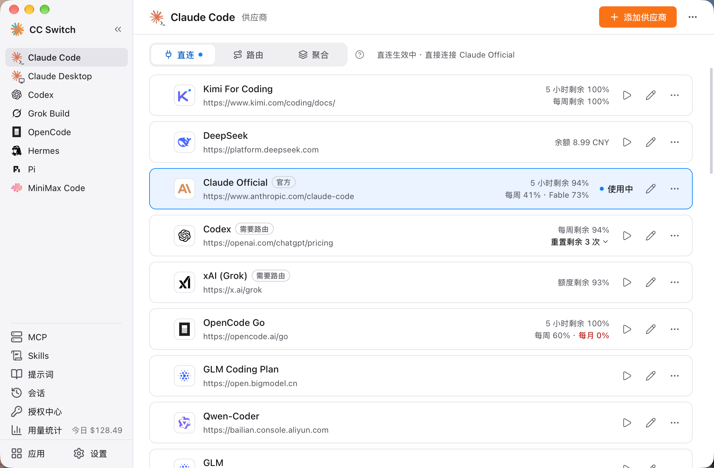
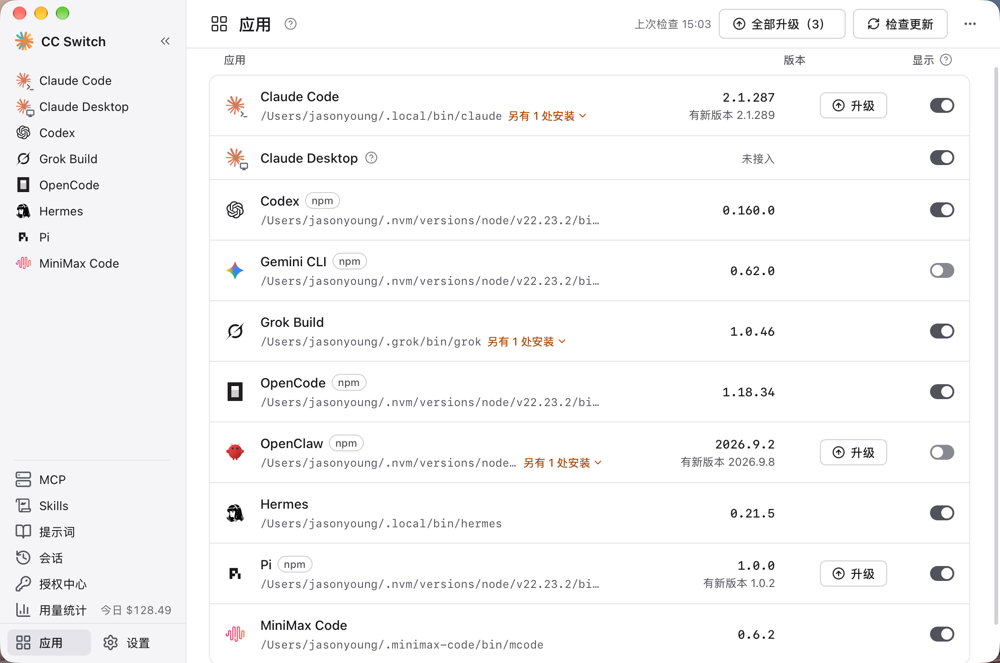
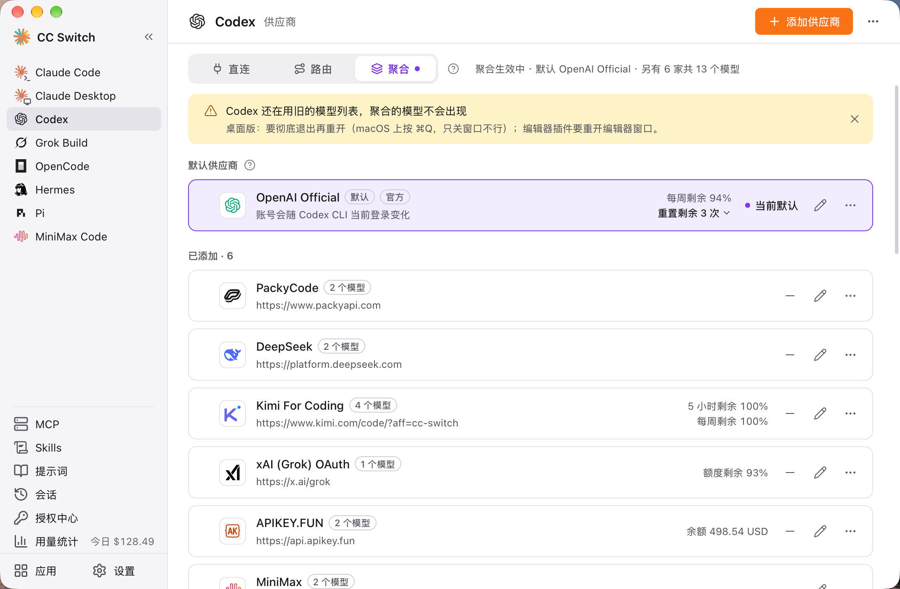
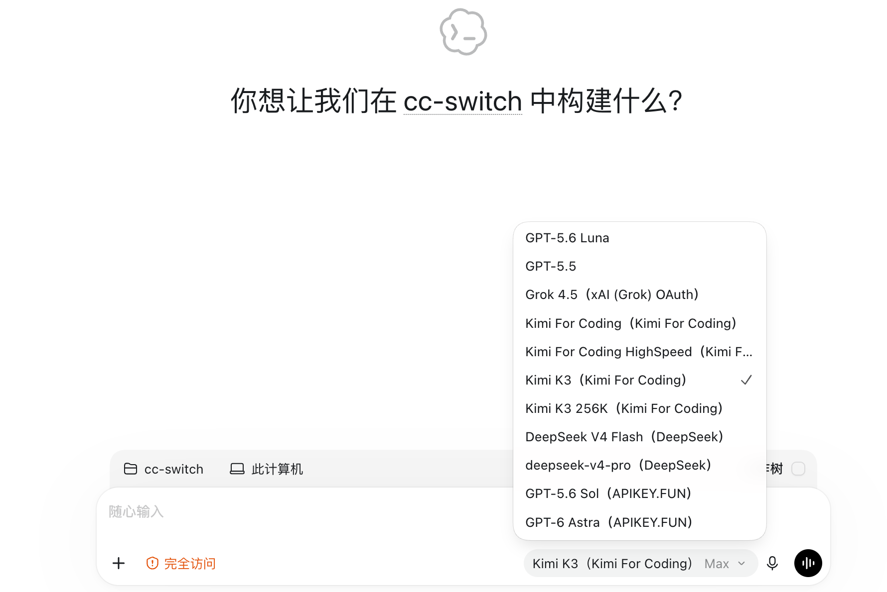
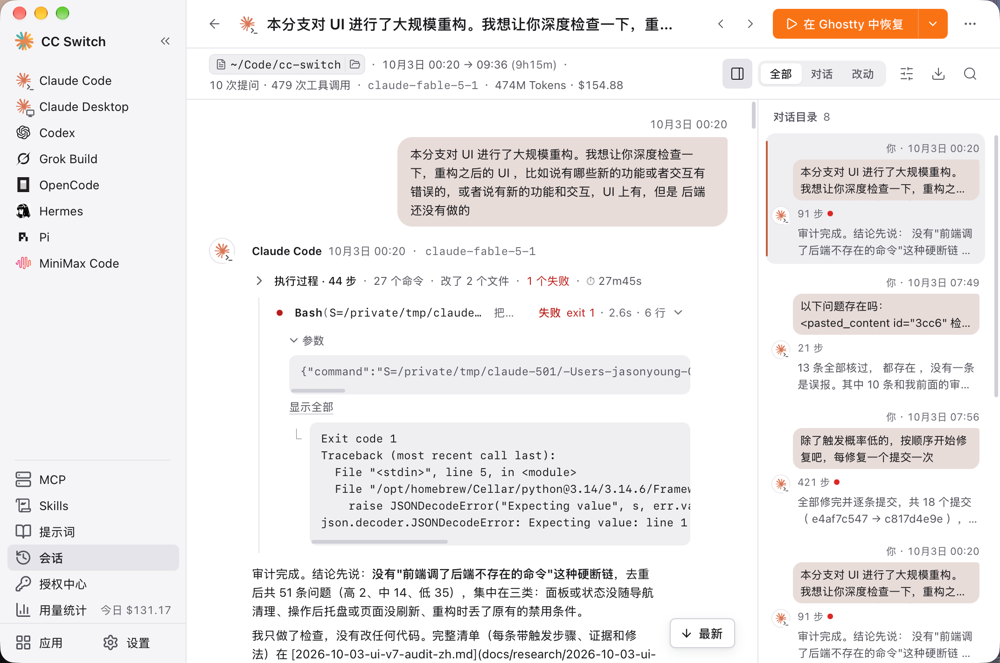
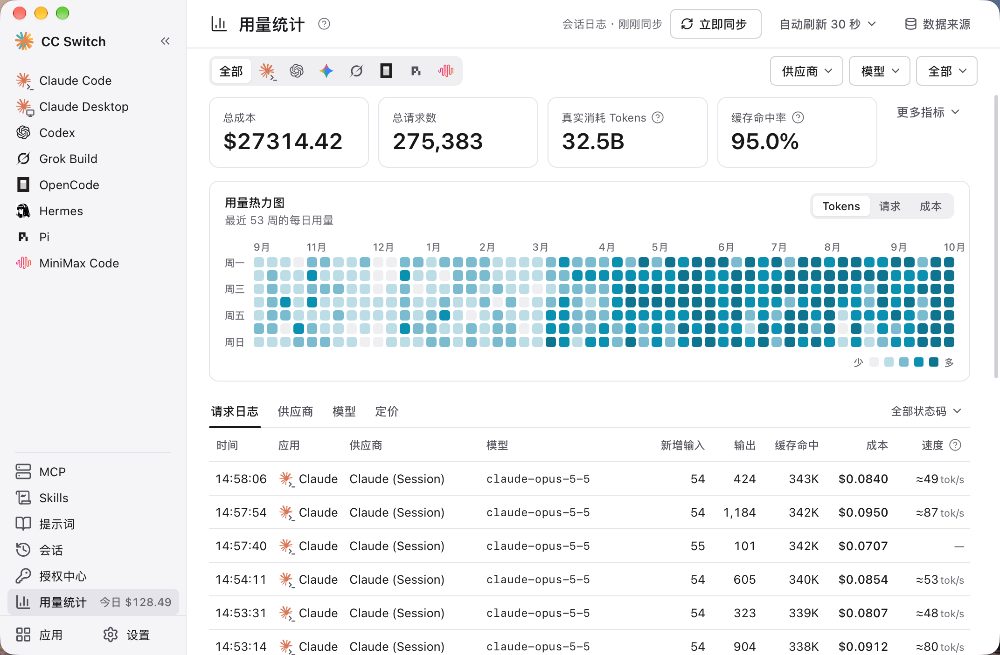

<div align="center">

# VV Code

### Claude Code、Claude Desktop、Codex、Gemini CLI、Grok Build、OpenCode、OpenClaw、Hermes Agent、Pi、MiniMax Code、Kimi Code、Oh My Pi 的全方位管理工具

**一键切换 API 供应商，统一管理 MCP、Skills 与提示词，不用再手改 JSON / TOML / YAML 配置文件。**

[](https://github.com/PiuQiuPiaQia/api-switch/releases)
[](https://github.com/PiuQiuPiaQia/api-switch/releases)
[](https://tauri.app/)
[](https://github.com/PiuQiuPiaQia/api-switch/releases/latest)

<a href="https://www.star-history.com/#PiuQiuPiaQia/api-switch&Date"><picture><source media="(prefers-color-scheme: dark)" srcset="https://api.star-history.com/badge?repo=PiuQiuPiaQia/api-switch&theme=dark" /></picture></a>

### 🌐 唯一官方网站：**[vvcode.top](https://vvcode.top)**

[English](README.md) | 中文 | [日本語](README_JA.md) | [Deutsch](README_DE.md) | [更新日志](CHANGELOG.md)

**[下载安装](#下载安装) · [快速开始](#快速开始) · [功能特性](#功能特性) · [常见问题](#常见问题) · [用户手册](docs/user-manual/zh/README.md)**

</div>

## 为什么选择 VV Code？

Claude Code、Codex、Gemini CLI 等 AI 编程工具各有各的配置格式。换一个 API 供应商，就得手动改 JSON、TOML、YAML 或 `.env` 文件；MCP、Skills 和提示词也要在每个工具里分别维护。

**VV Code** 把这些工作集中到一个桌面应用里：选一个预设、填入 Key，一键即可切换。切换时只替换地址、Key、模型这几项连接信息，你自己加的插件、Hook、MCP 和注释都原样保留。

- **一个应用，十二个工具** — Claude Code、Claude Desktop、Codex、Gemini CLI、Grok Build、OpenCode、OpenClaw、Hermes、Pi、MiniMax Code、Kimi Code、Oh My Pi
- **告别手动编辑** — 90+ 供应商预设，包括 AWS Bedrock、NVIDIA NIM 和社区中转服务
- **直连、路由、聚合，按需选择** — 直连是工具直接连供应商；路由经本机转发，能转换接口格式、自动故障转移，让 Claude Code 用 GPT、Codex 用 Claude；聚合把多家供应商的模型放进 Claude Code 或 Codex 的同一个模型列表，选哪个模型，请求就发给哪一家
- **MCP、Skills 与提示词集中管理** — MCP 和 Skills 添加一次，按工具勾选同步；提示词按工具分别维护
- **会话读得懂** — 把各工具的会话记录整理成阅读页：每一轮做了什么、改了哪些文件、哪一步失败了，一目了然
- **用量与额度一目了然** — 不开本地路由也能统计 Token 用量和花费；供应商卡片和托盘上直接显示订阅额度剩余量与账户余额
- **跨平台** — 基于 Tauri 2 构建的原生桌面应用，支持 Windows、macOS 和 Linux

## 界面预览

<table>
<tr>
<td align="center" width="50%"><br>主界面</td>
<td align="center" width="50%"><br>应用页</td>
</tr>
<tr>
<td align="center"><br>聚合模式</td>
<td align="center"><br>Codex 里的聚合模型列表</td>
</tr>
<tr>
<td align="center"><br>会话阅读页</td>
<td align="center"><br>用量统计</td>
</tr>
</table>

## 下载安装

### 系统要求

- **Windows**：Windows 10 及以上
- **macOS**：macOS 12 (Monterey) 及以上
- **Linux**：x86_64 或 ARM64，需要 glibc 2.35+ 和 WebKitGTK 4.1，例如 Ubuntu 22.04+、Debian 12+ 及较新的 Fedora；RHEL / Rocky / Alma 8–9 暂不支持

### Windows 用户

从 [Releases](../../releases) 页面下载最新版本的 `VV-Code-v{版本号}-Windows.msi` 安装包或 `VV-Code-v{版本号}-Windows-Portable.zip` 绿色版。ARM 版 Windows 请下载 `VV-Code-v{版本号}-Windows-arm64.msi` 或 `VV-Code-v{版本号}-Windows-arm64-Portable.zip`。

### macOS 用户

**手动下载**

从 [Releases](../../releases) 页面下载 `VV-Code-v{版本号}-macOS.dmg`（推荐）或 `.zip`。这是 Universal 通用包，Apple Silicon 和 Intel Mac 均可原生运行。

> **注意**：VV Code macOS 版本已通过 Apple 代码签名和公证，可直接安装打开。

### Linux 用户

从 [Releases](../../releases) 页面下载最新版本的 Linux 安装包：

- `VV-Code-v{版本号}-Linux-x86_64.deb` / `-Linux-arm64.deb`（Debian/Ubuntu）
- `VV-Code-v{版本号}-Linux-x86_64.rpm` / `-Linux-arm64.rpm`（Fedora 等提供 WebKitGTK 4.1 的 RPM 发行版）
- `VV-Code-v{版本号}-Linux-x86_64.AppImage` / `-Linux-arm64.AppImage`（满足上述系统要求的发行版）

> **Flatpak**：官方 Release 不包含 Flatpak 包。如需使用，可从 `.deb` 自行构建 — 参见 [`flatpak/README.md`](flatpak/README.md)。

## 快速开始

### 基本使用

1. **添加供应商**：在侧栏选中要管理的工具，点击页面右上角的“+”（添加供应商）→ 选择预设或创建自定义配置
2. **切换供应商**：
   - 主界面：选择供应商 → 点击“启用”（OpenCode、OpenClaw、Hermes、MiniMax Code、Kimi Code 的按钮为“添加”，Pi 和 Oh My Pi 为“启用 / 移除”；这七个是共存式工具，可以同时添加多个供应商）
   - 系统托盘：每个工具一行，显示“名称 · 模式 · 供应商 · 额度”，在子菜单里直接点击供应商名称（支持 Claude Code、Claude Desktop、Codex、Gemini CLI、Grok Build）
3. **生效方式**：Claude Code 无需重启；Codex、Gemini CLI、Grok Build 需重启终端或对应的 CLI 工具；Claude Desktop 需重启应用本身（详见常见问题）
4. **恢复官方登录**：切换到列表中自带的官方供应商（如“Claude Official”），重启工具后按照其登录/OAuth 流程操作
5. **路由与聚合（可选）**：Claude Code、Codex、Gemini CLI、Grok Build 的页面顶部有「直连 / 路由」标签，Claude Code 和 Codex 还有「聚合」。点标签只是切换查看的内容，不会改动配置；真正切换要点页面上的“开始路由”或“切换到聚合模式”，回到直连点“回到直连”。想在 Claude Code 里使用 OpenAI 或 Gemini 格式的供应商，或在 Codex 里使用 Claude，用路由；想在同一个模型列表里混用多家供应商的模型，用聚合
6. **管理工具**：侧栏的「应用」页集中显示每个 AI 编程工具的版本、安装位置和来源，可以安装、升级或全部升级，也可以选择哪些工具显示在侧栏

### MCP、提示词、Skills、项目与会话

- **MCP**：点击侧栏的“MCP” → 通过模板或自定义配置添加服务器（或“导入已有”）→ 切换各工具的同步开关
- **提示词**：点击侧栏的“提示词” → 使用 Markdown 编辑器创建提示词 → 启用后写入该工具的提示词文件
- **Skills**：点击侧栏的“Skills” →“发现技能” → 搜索 skills.sh 或浏览 GitHub 仓库 → 一键安装到支持的工具
- **项目**：先在「设置 → 通用」里打开“显示项目切换”，然后在 Claude Code、Claude Desktop 或 Codex 页面，打开顶部的项目切换器 →“新建项目”，把当前配置保存下来，之后从切换器里选择即可整套切换
- **会话**：点击侧栏的“会话” → 浏览、搜索会话历史，打开阅读页，或恢复各工具的会话
- **授权中心**：点击侧栏的“授权中心”，登录 GitHub Copilot、ChatGPT、xAI（Grok）、Kimi Code 账号，把订阅当作供应商使用。Kimi Code 支持同时保存多个官方账号，每个账号使用独立凭据和原生供应商，首个登录沿用 Kimi 原生默认凭据槽位，在此添加、重新登录和退出账号。仍在原生配置中的 Kimi 官方 OAuth 节点在供应商页受到保护；原生节点被移除后，可以删除留下的档案。

> **注意**：首次启动时，VV Code 会自动把 Claude Code、Codex、Gemini CLI、Grok Build 的现有配置导入为名为 `default` 的供应商，并为这几个工具和 Claude Desktop 添加官方供应商，原有配置不会丢失。

各项功能的详细用法请查阅 **[用户手册](docs/user-manual/zh/README.md)**，涵盖供应商管理、MCP/提示词/Skills、本地路由与故障转移等全部功能。

## 功能特性

[完整更新日志](CHANGELOG.md) | [v4.0 发布说明](docs/release-notes/v4.0.4-zh.md)

### 各工具支持的功能

| 工具                                          | 供应商 |  本地路由  | 聚合 | 托盘切换 | MCP | Skills | 提示词                           | 会话 |  用量统计  |
| --------------------------------------------- | ------ | :--------: | :--: | :------: | :-: | :----: | -------------------------------- | :--: | :--------: |
| Claude Code                                   | 切换   |     ✓      |  ✓   |    ✓     |  ✓  |   ✓    | CLAUDE.md                        |  ✓   |     ✓      |
| Claude Desktop                                | 切换   | 模型映射时 |  –   |    ✓     |  –  |   –    | –                                |  –   | 模型映射时 |
| Codex                                         | 切换   |     ✓      |  ✓   |    ✓     |  ✓  |   ✓    | AGENTS.md                        |  ✓   |     ✓      |
| Gemini CLI                                    | 切换   |     ✓      |  –   |    ✓     |  ✓  |   ✓    | GEMINI.md                        |  ✓   |     ✓      |
| Grok Build                                    | 切换   |     ✓      |  –   |    ✓     |  ✓  |   ✓    | AGENTS.md                        |  ✓   |     ✓      |
| OpenCode                                      | 共存   |     –      |  –   |    –     |  ✓  |   ✓    | AGENTS.md                        |  ✓   |     ✓      |
| OpenClaw                                      | 共存   |     –      |  –   |    –     |  –  |   –    | 工作区编辑器                     |  ✓   |     –      |
| Hermes                                        | 共存   |     –      |  –   |    –     |  ✓  |   ✓    | 记忆管理                         |  ✓   |     –      |
| Pi                                            | 共存   |     –      |  –   |    –     |  ✓  |   ✓    | AGENTS.md、SYSTEM.md、提示词模板 |  ✓   |     ✓      |
| MiniMax Code                                  | 共存   |     –      |  –   |    –     |  ✓  |   ✓    | AGENTS.md                        |  ✓   |     ✓      |
| [Kimi Code](docs/kimi-code-integration-zh.md) | 共存   |     –      |  –   |    –     |  ✓  |   ✓    | AGENTS.md                        |  ✓   |     ✓      |
| Oh My Pi                                      | 共存   |     –      |  –   |    –     |  ✓  |   ✓    | AGENTS.md                        |  ✓   |     –      |

- **切换**：同一时间只启用一个供应商；**共存**：多个供应商同时写入工具自身的配置，在工具里选择使用。
- **本地路由**：由 VV Code 在本机转发请求并转换接口格式，见下方[本地路由与故障转移](#本地路由与故障转移)。Claude Desktop 的供应商可选“直连”或“模型映射”，选“模型映射”时经本地路由转发。
- **聚合**：把多家供应商的模型放进同一个模型列表，按所选模型分发请求，见下方[聚合模式](#聚合模式)。
- **会话**：浏览、搜索会话历史，打开阅读页，复制恢复命令继续对话（OpenClaw、Hermes 的会话暂不支持恢复）。Hermes 只显示最近 500 个会话。
- **用量统计**：不开本地路由时，从各工具的本地会话记录统计；经本地路由的请求也会计入。
- 在 Claude Desktop 页面打开的 MCP、Skills、提示词和会话面板，作用于 Claude Code。

### 供应商管理

- **90+ 供应商预设** — 选择预设、填入 Key 即可添加，也可以创建自定义配置。添加面板支持按中文名和域名搜索，同一家的不同套餐和地区合并成一行
- **只改关键字段** — 切换时只替换请求地址、Key、模型等连接信息，插件、Hook、MCP、你自己加的设置和注释都原样保留；编辑器底部显示切换后配置文件的样子，VV Code 第一次改写配置文件前会自动备份原文件
- **项目** — 把 Claude Code 或 Codex 当前的供应商、MCP、Skills 和提示词文件保存为一个项目（Claude Desktop 只保存供应商），之后在页面顶部的项目切换器或托盘里一键整套切换；切到其他项目时，当前状态会自动存回原项目。项目切换器默认隐藏，在「设置 → 通用」里打开“显示项目切换”
- **授权中心（Beta）** — 在侧栏的「授权中心」里登录多个 GitHub Copilot、ChatGPT、xAI（Grok）账号，把订阅当作供应商用在 Claude Code、Claude Desktop 和 Codex 中（除 Codex 的 OpenAI Official 外，都需要在路由模式下使用）。在官方客户端以外使用订阅可能违反厂商的服务条款，请自行评估风险
- **Claude Desktop 接入第三方** — 可以直连 Anthropic 兼容端点；非 Claude 模型选“模型映射”，经本地路由把 Sonnet、Opus、Haiku 等档位映射到供应商的实际模型
- **通用供应商** — 一份配置同步到 Claude Code、Codex 和 Gemini CLI
- 一键切换、系统托盘快速切换（Claude Code、Claude Desktop、Codex、Gemini CLI、Grok Build）、拖拽排序、导入导出

### 本地路由与故障转移

- **接口格式转换** — 本地路由在 Anthropic Messages、OpenAI Chat Completions、OpenAI Responses 和 Gemini Native 之间转换请求格式：Claude Code 和 Claude Desktop 可以使用 OpenAI 或 Gemini 格式的供应商，Codex 和 Grok Build 可以使用 Chat Completions 或 Anthropic Messages 格式的供应商
- **按工具开启** — Claude Code、Codex、Gemini CLI、Grok Build 可以分别进入路由模式：在页面顶部的「路由」标签里点“开始路由”。路由模式下，切换供应商会立即作用于后续请求（如果切换改变了模型，Codex、Gemini CLI 和 Grok Build 仍可能需要重启）。退出 VV Code 时会先写回直连配置，下次启动再接上
- **自动故障转移** — 为每个工具配置故障转移队列，请求失败时按队列顺序自动改用下一个供应商，配合熔断器和供应商健康监控
- **整流器** — 自动修正部分上游不兼容的请求（如 Thinking 签名、不支持图片时降级）
- 官方供应商（如 Claude Official）不能走本地路由（Codex 的 OpenAI Official 除外）
- 路由服务的状态、监听地址和故障转移参数集中在「设置 → 本地路由」
- 使用攻略：[在 Claude Code 中使用 GPT](docs/guides/claude-codex-routing-guide-zh.md) · [在 Codex 中使用 Claude](docs/guides/codex-claude-routing-guide-zh.md)

### 聚合模式

- **一个模型列表，多家供应商** — 在 Claude Code 或 Codex 的页面切到「聚合」，添加几家供应商，它们的模型会同时出现在客户端的模型选择器里；选哪个模型，请求就发给哪一家，不用回到 VV Code 切换
- **随时添加和移除** — 在供应商卡片上点“添加”或“移除”，再选一家作为默认供应商，没有指定聚合模型的请求都交给它；Codex 的 OpenAI Official 只能作为默认供应商；聚合模式暂不支持 Claude 官方订阅
- **注意** — 聚合不提供故障转移；Claude Code 需要 2.1.243 或更新版本；Codex 的聚合列表变化后需要重启，Claude Code 不需要。同一会话里换模型后，新模型要重新建立提示词缓存，第一轮费用会高一些
- 聚合模式的许多设计参考了 [opencodex](https://github.com/lidge-jun/opencodex)，感谢作者和贡献者
- 使用攻略：[聚合模式图文指南](docs/guides/aggregation-mode-guide-zh.md) · [聚合模式手册](docs/user-manual/zh/4-proxy/4.6-aggregation.md)

### MCP、提示词与 Skills

- **统一 MCP 面板** — 一处管理所有 MCP 服务器，按工具勾选同步（Claude Code、Codex、Gemini CLI、Grok Build、OpenCode、Hermes、Pi、MiniMax Code、Kimi Code、Oh My Pi），支持从各工具导入现有配置，支持 Deep Link 导入
- **提示词** — 按工具分别管理的提示词库，使用 Markdown 编辑器；启用后写入该工具的提示词文件（CLAUDE.md / AGENTS.md / GEMINI.md），启用前会先把文件里原有的内容存回提示词库，不会丢失。Pi 还可以编辑 SYSTEM.md、APPEND_SYSTEM.md 和提示词模板
- **Skills** — 搜索 skills.sh，或从 GitHub 仓库、ZIP 文件一键安装；检查更新并一键全部更新；同步到各工具的方式可选自动、只用软链接或只用复制，存储位置可选 `~/.agents/skills`
- 三个面板都支持搜索，MCP 和 Skills 还可以按工具一键全部启用或停用；供应商、MCP 和提示词都在内容区整页编辑，有未保存的修改时离开会先提醒

### 用量与成本追踪

- **用量仪表盘** — 不开本地路由也能统计：默认自动扫描各工具的本地会话记录，按供应商和模型统计请求数、Token、缓存命中率、输出速度和花费，提供趋势图、全年热力图和逐条请求日志
- **额度与余额** — 供应商卡片和托盘上直接显示剩余量和重置倒计时，比如“5 小时剩余 94%”：官方订阅额度（Claude、ChatGPT、Gemini、SuperGrok）、Coding Plan 的 5 小时 / 周 / 月额度（Kimi、智谱 GLM、MiniMax、火山方舟等）和账户余额（DeepSeek、OpenRouter、硅基流动等），部分需要先在供应商卡片的“配置用量查询”里开启；其他供应商可以写自定义用量脚本。ChatGPT 订阅还会显示剩余重置次数和 Codex Credits 余额
- **自定义定价** — 按模型设置单价，可以从 models.dev 导入

### 会话管理器与工作区

- **会话阅读页** — 把各工具的会话记录解析成结构化内容：正文、思考、工具调用、工具结果和图片分开呈现；每一轮工作折叠成一行摘要（多少步、改了几个文件、几处失败），失败步骤标红；右侧是对话目录，支持会话内查找、导出 Markdown、复制单轮或整段对话
- **列表与恢复** — 按项目或时间分组，搜索标题、目录、消息或会话 ID，支持批量删除；复制恢复命令继续对话，macOS 上可以一键在终端中恢复
- **工作区编辑器**（OpenClaw）— 编辑 Agent 文件（AGENTS.md、SOUL.md 等）和每日记忆
- **记忆管理**（Hermes）— 编辑 Hermes 的 MEMORY.md 和 USER.md

### 系统与平台

- **云同步** — 通过 WebDAV（坚果云、Nextcloud、群晖 NAS 等）或 S3 兼容存储（AWS S3、Cloudflare R2、阿里云 OSS、腾讯云 COS 等）在多台设备之间同步；也可以把 VV Code 配置目录放到 Dropbox、OneDrive、iCloud 等网盘文件夹中
- **CLI 工具管理** — 在侧栏的「应用」页查看 Claude Code、Codex 等命令行工具的当前版本和最新版本，一键安装、升级或全部升级，并诊断重复安装；Windows 上还能管理 WSL 里的工具（见常见问题）
- **Deep Link**（`ccswitch://`）— 通过链接一键导入供应商、MCP 服务器和提示词，或添加技能仓库。用 [在线生成器](https://vvcode.top/deplink.html) 生成链接；站长想在网站上放导入按钮，见 [站长接入指南](https://github.com/PiuQiuPiaQia/api-switch/blob/main/docs/guides/deeplink-site-integration-guide-zh.md)
- **小工具** — 跳过 Claude Code 初次安装确认、隐藏 AI 署名、让 VS Code 的 Claude Code 插件随本软件切换供应商等
- 深色 / 浅色 / 跟随系统主题、开机自启、自动更新、原子写入、自动备份（「设置 → 数据」里可以看到所有备份的位置和占用空间）、国际化（简中/繁中/英/日，另有社区翻译的土耳其语）

## 常见问题

<details>
<summary><strong>VV Code 支持哪些 AI 工具？</strong></summary>

VV Code 支持十二个工具：**Claude Code**、**Claude Desktop**、**Codex**、**Gemini CLI**、**Grok Build**、**OpenCode**、**OpenClaw**、**Hermes**、**Pi**、**MiniMax Code**、**Kimi Code**、**Oh My Pi**。每个工具都有专属的供应商预设和配置管理，各自支持哪些功能见[各工具支持的功能](#各工具支持的功能)。

</details>

<details>
<summary><strong>切换供应商后需要重启终端吗？</strong></summary>

视工具而定：

- **Claude Code**：支持供应商数据的热切换，无需重启。
- **Codex、Gemini CLI、Grok Build**：需要重启终端或 CLI 工具才能生效（切换成功后会有提示）。路由模式下，请求会立即转发到新供应商；但如果切换改变了模型，这三个工具仍可能需要重启。
- **聚合模式**：Claude Code 的聚合模型改动立即生效；Codex 进入或退出聚合、改动聚合模型列表后都要彻底重启，见下一条。
- **Claude Desktop**：需要完全退出并重新打开 Claude Desktop；使用“模型映射”时，还需要保持 VV Code 运行。
- **OpenCode、OpenClaw、Hermes、Pi、MiniMax Code、Kimi Code、Oh My Pi**：这些是共存式工具，点击“添加”（Pi 和 Oh My Pi 为“启用”）会把供应商写入工具自身的配置、与其他供应商共存，之后在工具里选择要使用的模型即可。Kimi Code 还提供“切换”按钮选择供应商的模型；主模型或子代理模型池仍引用的模型不能移除。配置与账号详情见 [Kimi Code 接入说明](docs/kimi-code-integration-zh.md)。

</details>

<details>
<summary><strong>Codex 聚合模式下，/model 里看不到聚合的模型？</strong></summary>

Codex 只在启动时读取模型列表。进入或退出聚合模式、添加或移除聚合的供应商、改动某家的聚合模型之后，都要彻底重启 Codex 才能看到新的列表：

- **Codex CLI**：只关掉终端重开 `codex` 不够。所有终端里的 `codex` 共用一个后台守护进程，要重启它才会读到新列表。VV Code 检测到 Codex 还在用旧列表时，会在 Codex 页面顶部提示，点提示里的“重启 Codex 守护进程”即可。重启会中断守护进程里正在运行的任务。
- **Codex 桌面版**：要彻底退出后重新打开（macOS 上按 ⌘Q，只关窗口不行）。
- **编辑器插件**：重开编辑器窗口。

Claude Code 不受影响，聚合模型改动立即生效。

</details>

<details>
<summary><strong>切换供应商会改掉我的插件、Hook 等设置吗？</strong></summary>

不会。Claude Code、Codex、Gemini CLI、Grok Build 切换供应商时，VV Code 只替换配置文件里的**关键字段**：请求地址、Key、模型名和接口协议（Codex 还包括推理档位，Gemini CLI 还包括认证方式），以及少数跟着供应商走的兼容选项（如 Claude Code 的“禁用 Artifact 工具”、上下文窗口）。插件、Hook、权限、MCP、你自己加的环境变量、注释和排版都原样保留，对所有供应商生效。

这些共享设置可以直接在工具里改，或手动编辑配置文件；也可以在 VV Code 里编辑任意一个供应商：编辑框显示的是“切到这个供应商之后配置文件的样子”，保存时关键字段存进这个供应商，其余改动写进配置文件，对所有供应商生效。

所以以前的“通用配置片段”已经不需要了，相关按钮已移除。升级前片段里的设置在切换时早已写进配置文件，会继续保留。VV Code 第一次改写每个配置文件之前，还会把原文件备份到 `~/.vv-code/backups/live-first-write/`。

</details>

<details>
<summary><strong>在工具里换了模型，切走再切回来怎么又变回去了？</strong></summary>

模型属于关键字段，归供应商所有。在工具里换的模型（如 Claude Code 的 `/model`）会一直生效到下次切换；切换时，配置文件里的模型会换成目标供应商保存的那个，VV Code 不会把你在工具里换的模型存回原来的供应商。想长期使用某个模型，请在 VV Code 里编辑这个供应商。

旧版本会在切走时把整份配置文件存回供应商，现在不再这样做：那样会把插件等共享设置冻结进某一个供应商，切到别的供应商时就丢了。

</details>

<details>
<summary><strong>为什么总有一个正在使用的供应商无法删除？</strong></summary>

本软件的设计原则是“最小侵入性”，即使卸载本软件，也不会影响应用的正常使用。

所以对于同一时间只启用一个供应商的工具（Claude Code、Claude Desktop、Codex、Gemini CLI、Grok Build），系统总会保留一个正在使用的配置，因为如果将所有配置全部删除，该应用将无法正常使用；想删它，先切换到别家。聚合模式下的默认供应商同样不能移除，先把别家设为默认。OpenCode、OpenClaw、Hermes、Pi、MiniMax Code 等共存式工具不受此限制，可以直接删除任意供应商。如果你不常用某个工具，可以在侧栏的「应用」页里把它从侧栏隐藏。如果你想切换回官方登录，可以参考下条。

</details>

<details>
<summary><strong>如何切换回官方登录？</strong></summary>

Claude Code、Claude Desktop、Codex、Gemini CLI、Grok Build 的供应商列表里都自带一个官方供应商（**Claude Official**、**Claude Desktop Official**、**OpenAI Official**、**Google Official**、**Grok Official**），如果删掉了，可以从预设里重新添加。切换到官方供应商后，按照工具自身的登录流程操作（如 Claude Code 的 `/login`、Codex 的 `codex login`），之后便可以在官方供应商和第三方供应商之间随意切换。

Codex 还可以在 VV Code 里用“使用 ChatGPT 登录”登录多个 ChatGPT 账号，再为每张 **OpenAI Official** 卡片选择“使用的账号”，多个 Plus、Pro 或 Team 账号之间一键切换；选择“跟随 Codex 登录”的卡片则沿用 Codex CLI 自己的登录。

注意：官方订阅用的是工具自己的登录，不经过本地路由。路由模式下不能切换到官方供应商（Codex 的 OpenAI Official 卡片除外），先回到直连即可。

</details>

<details>
<summary><strong>开始路由后，配置文件里的地址为什么变成了 127.0.0.1？</strong></summary>

路由模式下，工具的请求会先发到 VV Code 的本地路由（默认 `http://127.0.0.1:15721`），再由 VV Code 转发给你选中的供应商。所以工具的配置文件里只有本地地址和占位密钥 `PROXY_MANAGED`；Claude Code 的模型名还会写成 `claude-sonnet-5` 之类的固定别名（`/model` 菜单里仍显示真实模型名）。真实的供应商地址、密钥和模型都保存在 VV Code 里。聚合模式同样如此。

在侧栏「用量统计」的请求日志里可以看到每条请求的“请求模型 → 实际模型”。

路由模式下，切换的是路由使用的供应商，进入路由前在用的供应商保持不变，卡片上标“直连”。点“回到直连”后，配置文件会写回这个直连供应商的配置。退出 VV Code 时也会先写回直连供应商，下次启动再重新接上。

</details>

<details>
<summary><strong>能在 Claude Code 里使用 OpenAI 兼容接口、Gemini 或本地模型吗？</strong></summary>

可以，但需要使用路由。编辑供应商时，在“高级选项”的“上游格式”里选择和供应商一致的接口格式：只提供 Chat Completions 接口的服务（很多本地模型服务都是这样）选“OpenAI Chat Completions”，提供 Responses 接口的选“OpenAI Responses API”，Gemini 选“Gemini Native generateContent”。然后在 Claude Code 页面的「路由」标签里点“开始路由”。格式选错或没有开始路由，通常会报 404 或 405 错误。

反过来，在 Codex 或 Grok Build 的“上游格式”里选“Anthropic Messages”，就能使用 Claude 格式的供应商，同样需要路由。详见[在 Claude Code 中使用 GPT](docs/guides/claude-codex-routing-guide-zh.md) 和 [在 Codex 中使用 Claude](docs/guides/codex-claude-routing-guide-zh.md)。

</details>

<details>
<summary><strong>“检测连通”通过了，为什么请求还是失败？</strong></summary>

供应商卡片上的“检测连通”只检查供应商地址能不能连上，不会发送真实的模型请求，所以验证不了 API Key 和模型名是否正确。请求失败时，请检查 Key、模型名和上游格式；经过路由的请求，还可以在侧栏「用量统计」的请求日志里查看具体报错。

</details>

<details>
<summary><strong>我的数据存储在哪里？</strong></summary>

默认都在用户主目录下的 `.vv-code` 文件夹（Windows 为 `C:\Users\<用户名>\.vv-code`）：

- **数据库**：`vv-code.db`（SQLite — 供应商、MCP、提示词、Skills、项目、用量记录等）
- **本地设置**：`settings.json`（设备级设置，如各工具的配置目录、备份策略、云同步连接信息）
- **备份**：`backups/`（默认每 24 小时自动备份一次、保留最近 10 个，可在「设置 → 数据 → 备份与恢复」中调整；下方的“其他备份”列出其余备份的位置和大小，可以按类别清理）
- **Skills**：`skills/`（可在设置中改为 `~/.agents/skills`），默认通过软链接同步到各工具，失败时改为复制
- **技能备份**：`skill-backups/`（卸载或更新技能前自动创建，保留最近 20 个）
- **OAuth 登录凭据**：`copilot_auth.json`、`codex_oauth_auth.json`、`xai_oauth_auth.json`
- **日志**：`logs/vv-code.log` 和 `crash.log`，反馈问题时请附上
- **本机状态**：`live-state.json`（各工具当前是直连、路由还是聚合，上一次写入了什么）、`codex-login-stash.json`（切到第三方时被移走的 Codex 官方登录，切回官方时还原）
- **配置文件原件**：`backups/live-first-write/`（VV Code 第一次改写各工具配置文件之前的原文件）

在「设置 → 数据 → 存储位置」里修改“VV Code 配置目录”后，除 `settings.json`、本机状态和配置文件原件以外的上述文件都改为存放在新目录。VV Code 不会自动搬运已有文件，需要先手动复制过去。`settings.json`、本机状态和配置文件原件只属于这台电脑，始终在默认目录，也不参与云同步。

</details>

<details>
<summary><strong>在 Windows 上怎么管理 WSL 里的工具？</strong></summary>

VV Code 不会自动识别 WSL。请在「设置 → 应用配置」里，把对应工具的配置目录改成 WSL 里的路径，例如 `\\wsl.localhost\Ubuntu\home\<用户名>\.claude`，保存后 VV Code 就会读写 WSL 里的配置（Claude Code、Codex、Gemini CLI、Grok Build、OpenCode、OpenClaw、Hermes、Pi 支持设置）。设置之后，侧栏的「应用」页也会在对应的 WSL 发行版里检测和升级该工具。

注意：路由和聚合写入配置的地址是 `127.0.0.1`。WSL2 默认的 NAT 网络模式下，WSL 里的 `127.0.0.1` 连不到 Windows 上的本地路由，需要改用 WSL 的 mirrored 网络模式。

</details>

<details>
<summary><strong>有命令行版本或无界面版本吗？</strong></summary>

VV Code 本身只提供需要图形界面的桌面版（系统要求见[下载安装](#下载安装)）。在服务器、SSH 远程或没有桌面环境的机器上，推荐使用社区维护的 **[VV Code CLI](https://github.com/SaladDay/cc-switch-cli)**：它提供交互式终端界面（TUI）和命令行两种用法，支持 Claude Code、Codex、Gemini CLI、OpenCode、OpenClaw、Hermes、Pi，可以通过 Homebrew（`brew install cc-switch-cli`）或安装脚本安装。

VV Code CLI 默认与桌面版共用数据目录 `~/.vv-code`，也兼容桌面版的 WebDAV 同步。两个项目分别发版，CLI 版支持的数据库版本有时会落后于桌面版；遇到“数据库版本过新”的提示时，请升级 CLI 版，或等它跟进更新。

</details>

<details>
<summary><strong>Linux（Wayland + NVIDIA）：网页内容点不动、缩放后黑屏</strong></summary>

AppImage 会强制 `GDK_BACKEND=x11`（走 XWayland）以规避历史上的原生 Wayland 崩溃。但在较新的 Wayland + NVIDIA 环境下，这会导致网页内容区点不动（标题栏按钮仍可点）、窗口缩放后黑屏。可用内置的逃生开关切回原生 Wayland：

```bash
VV_CODE_GDK_BACKEND=wayland ./VV-Code-*.AppImage
```

如果你是从桌面图标启动的，请把它写进 `.desktop` 的 `Exec=` 行（如 `env CC_SWITCH_GDK_BACKEND=wayland /path/to/AppImage`），或在会话环境中设置。该变量是通用的：在 tiling Wayland 合成器（sway/Hyprland）下若出现点击失效，可反过来设 `CC_SWITCH_GDK_BACKEND=x11`。不设置则保持默认行为。

</details>

更多问题请查看用户手册中的[常见问题](docs/user-manual/zh/5-faq/5.2-questions.md)。

## 贡献

欢迎提交 Issue 反馈问题和建议！新功能开发前，请先开 Issue 讨论实现方案，不适合项目的功能性 PR 有可能会被关闭。

开发环境、提交前检查和架构说明见 [CONTRIBUTING.md](CONTRIBUTING.md#贡献指南)；使用问题请先看 [SUPPORT.md](SUPPORT.md)；安全漏洞请按 [SECURITY.md](SECURITY.md) 私下报告。

**技术栈**：Tauri 2 · Rust · React 18 · TypeScript · SQLite

## Star History

[](https://www.star-history.com/#PiuQiuPiaQia/api-switch&Date)

## License

MIT © Jason Young
